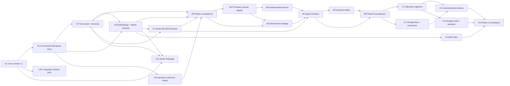

# Weave roadmap: Phases A, B and C

Status: **approved by the owner on 2026-10-18**, with four amendments (A2
storage abstraction, A7 read-only MCP preview, one store per tenant in B3, and
an external-first telemetry boundary in C1). This document replaces the gate sequence in [IMPLEMENTATION_PLAN.md](IMPLEMENTATION_PLAN.md)
and [WORKFLOW.md](WORKFLOW.md), which remain as the original white-paper record.
The goals are in [VISION.md](../VISION.md). The evidence behind the decisions is
in the [17 October audit](AUDIT_2026-10-17.md). The proposed GitHub issue changes
and full issue texts are in [ROADMAP_PROPOSAL.md](ROADMAP_PROPOSAL.md).

## Why reorganize

The existing epics E01–E15 and L0–L7 follow the original white papers, which
centre a decentralized, offline-first, event-driven runtime. Large parts of that
are built and well tested. However, the three goals now set for Weave depend on
capabilities the gates never prioritized:

- incremental fact-level writes instead of full-snapshot commits;
- per-fact provenance;
- k-hop traversal and "what changed" queries;
- one time-aware embeddings layer linked to the plan algebra;
- authenticated multi-user access with groups and agent identities.

Meanwhile, effort went to subsystems that none of the three goals needs first:
actors, compiled handlers, browser images, peer traces and governed effects.

The new plan keeps everything already built. It changes the **order** of work
and the **acceptance criteria**, so each phase delivers something usable for
the stated goals.

## Phase A: rock-solid shared core

**Status: complete** (A6, [#16](https://github.com/weave-graph/weave-engine/issues/16)),
released as protocol 1.0.0 ([release notes](../CHANGELOG.md)). The exit scenario runs in CI on
Linux, macOS and Windows ([check](PHASE_A_EXIT.md)), and the language reached Phase A parity
(LA1, weave-language#3).

**Outcome:** a local, embeddable temporal graph database with per-fact
provenance and a time-aware embeddings layer. It is usable from Rust, JSON and
Python, and it is a credible foundation for a hardware fleet knowledge base and
hybrid RAG.

| ID | Epic | Builds on | Summary |
|---|---|---|---|
| A1 | Core contract v1 | E01 (#2) | One consolidated, versioned specification of the core subset: identity, facts, bitemporal time, provenance, embeddings and queries. Includes a compatibility policy and golden fixtures shared with the language |
| A2 | Incremental bitemporal fact store | E02 (#3) | Append and retract individual facts; valid time on nodes and properties; engine-recorded per-fact provenance; indexes by entity, predicate and time; snapshots become derived checkpoints; per-graph caps removed. Introduces a storage abstraction (a fact-log and index trait with SQLite as the first backend) so the C4 backend decision is not a rewrite |
| A3 | Time travel, traversal and provenance queries | E03 (#4) | k-hop expansion, as-of valid/recorded selection, change sets between two times plus a pull change feed, explain to source facts, explicit coverage |
| A4 | Embeddings layer and hybrid retrieval | E12 (#13) | Vectors as temporal facts in typed spaces; an exact kNN plan operator with time and permission filters; graph-to-vector and vector-to-graph composition; candidate relations with provenance |
| A5 | Hardware reference model and importers | new (#36) | Reference schema for assets, parts, firmware, sites, sensors, series references, users and organizations; CSV/JSON importers; a realistic example dataset |
| A7 | Read-only MCP preview | new (#37) | A small local MCP server exposing `query`, `expand`, `as_of`, `hybrid_search` and `explain` over a local store, so the owner's agents can dogfood the core early. No writes, no authentication; B4 builds the full write-capable interface on top of it |
| A6 | Phase A acceptance and release | E15 (#16), core part of E14 (#15) | An integrated scenario, fuzzing for the new write and query paths, store 29 migration, baseline benchmarks, a tagged release |

**Progress.** A1 engine side: [core contract v1](contract/core-v1.md) is
accepted, with golden fixtures, stable decode error codes, the compatibility
policy, the 0.1–0.21 classification, and ADR-0005 and ADR-0006. The protocol
stays 0.21.0. A1 closes when weave-language runs the vendored fixtures in its CI
(LA0).

A2 in progress: [ADR-0004](architecture/ADR-0004-fact-log-and-storage-backend.md)
is accepted. The `FactBackend` storage trait, its SQLite backend, an in-memory
reference backend and their conformance suite are merged, with a CI check that
only the SQLite backend issues SQL against fact-store tables. The engine does
use it from protocol 0.22.0 and store 30: the `write` command, fact revisions,
node valid time, per-fact provenance in results and the crash-tested store
29→30 migration. Part 3 adds indexed reads, removes the per-graph object and
head-observation caps, measures single-fact commits at 10k/100k/1M facts and
adds incremental science import. A2 is complete.

A5: the [hardware reference model](HARDWARE_MODEL.md) ships in the
`weave-hardware` crate: the schema, `SeriesRef`, idempotent CSV/JSON
importers through fact writes, and a seeded 5,000-unit generator with 1,000
updates. Its fleet scenario covers exit questions 2 and 5 with the current
operators; A4's `tests/fleet_hybrid.rs` answers questions 3 and 4 on the same
fleet.
A3 is complete: protocol 0.23.0 adds the `expand` (k-hop), `as_of` and
`changes` (change set and pull feed) graph expressions, with explanations
through `fact_provenance`, explicit coverage and paired hidden-input tests
([guide](TRAVERSAL.md)). They are available from Rust, the science JSON
interface and Python ([tutorial](PYTHON_SCIENCE.md#traversal-as-of-reads-and-change-sets)),
and the A5 fleet scenario answers "as known at K" for restricted readers.
A7 is complete: the [read-only MCP preview](MCP_PREVIEW.md) (`weave-mcp`)
serves `query`, `expand`, `as_of`, `what_changed`, `hybrid_search` (A4
`nearest` and `similar_candidates`) and `explain` over stdio as a fixed
reader, and a scripted MCP client answers exit questions 2 to 4 on the fleet
through it.
A4 is complete: protocol 0.24.0 and store 31 activate embedding facts and
spaces (ADR-0006) and add the exact `nearest` operator with time and
permission filters, graph-to-vector and vector-to-graph composition
(`candidates`, `seeds_from`), `similar_candidates` candidate relations with
provenance, an explicit migration from the untyped `vector` property, and
answers to exit questions 3 and 4 on the fleet ([guide](EMBEDDINGS.md)).
A6 is complete:
- **Exit scenario.** The whole [exit scenario](PHASE_A_EXIT.md) runs in CI on
  three OSes.
- **Fuzzing.** Fuzz targets cover the write, A3, A4 and MCP paths.
- **Migration.** A populated store 29 reaches store 31, both directly and
  through store 30.
- **Benchmarks.** Baseline numbers are recorded, including `nearest` with
  candidates, whose cost follows the candidates
  ([benchmarks](benchmarks/README.md)).
- **Quickstart.** The README has a five-command quickstart.
- **Protocol 1.0.0.** Every feature gate now reads one version table
  ([note](contract/v1.0/README.md)).
`nearest` streams with O(k) memory under its own scan budget; 100,000
embeddings of 1,536 dimensions are measured for upsert and exact top-10
([report](benchmarks/embeddings-2026-10-20.json)), and Python has helpers
and a hybrid-retrieval tutorial.

**Phase A exit scenario:** import a fleet of 5,000 units with parts, firmware,
sites, owners, sensor series references and maintenance notes with embeddings.
Then:

1. Apply 1,000 incremental corrections and firmware rollouts as individual fact
   writes.
2. Answer "which units at site S ran firmware F on date D, as we knew it on date
   K" and "what changed for unit U between K1 and K2".
3. Retrieve maintenance notes semantically similar to an incident, restricted to
   the 2-hop neighborhood of affected units and valid at the incident time.
4. Surface two similar-unit candidate relations that are absent from the graph,
   each with provenance.
5. Show that existing per-record reader restrictions still hide restricted
   units in every result above.

Every answer explains its source facts and is reproducible after reopening the
database. Questions 2 to 4 are also answered by an agent through the A7
read-only MCP preview.

## Phase B: permissions and agent knowledge sharing

**Outcome:** a multi-user Weave service in which people, teams and their agents
write and query shared knowledge, with permissions, derived-fact leakage
protection, audit and optional review.

| ID | Epic | Builds on | Summary |
|---|---|---|---|
| B1 | Principals, groups and agent identities | new (#38), split from E04 (#5) | A principal registry for users, groups, teams and agents (each owned by a principal, with narrowed delegated scope); group-resolved readers; graph-level ACLs; the Discover permission; membership revocation. **Complete:** registry, groups, agents with delegated scope, ACLs, Discover and revocation (protocol 1.1.0, store 32) |
| B2 | Derived-fact leakage protection | E04 (#5) | Write-time restriction propagation; influence on analytics, kNN results and embeddings; release policies; a property-based noninterference harness covering every operator |
| B3 | Authenticated Weave service | new (#39) | A long-running server with authentication mapped to principals; tenant isolation by one store per tenant (row-level tenant keys only if later needed); a read and write audit log, and reuse of signed admission for agent capabilities. **Complete:** `weave-service` with TLS, user and agent API tokens, OIDC, signed admission for agent capabilities, one store per tenant, a read/write audit log, minted IDs and a published 50-client load measurement |
| B4 | Agent interface (MCP and SDK) | new (#40) | Extends the A7 preview into the full write-capable interface: tools to assert, retract, query, time travel, ask what changed, run hybrid search and explain. Facts are stamped with agent identity and method; quotas; a data/code boundary against injected content |
| B5 | Optional review of shared knowledge | E11 (#12) | **Last in Phase B.** Agents propose into a team graph and reviewers accept; personal graphs publish immediately; reuses the existing governance |
| B6 | Phase B acceptance | new (#41) | An integrated multi-team, multi-agent scenario with leakage tests |

**Phase B exit scenario:** two teams, each with a human and two agents, share
one Weave service. Agents assert facts from maintenance logs and query each
other's published knowledge. A customer-restricted graph never influences the
other team's results, counts, rankings, explanations, embeddings or kNN
candidates. The property harness runs at least 10,000 generated cases per
operator. Revoking an agent takes effect on its next request. The audit log
shows who read and wrote each fact.

## Phase C: scale for high-volume telemetry

**Outcome:** Weave ingests and relates high-rate telemetry and keeps derived
facts current, with measured throughput and bounded storage.

| ID | Epic | Builds on | Summary |
|---|---|---|---|
| C1 | Telemetry ingestion and series linkage | new (#42) | A decision record on the series storage boundary, leaning toward keeping raw telemetry in external Parquet or a TSDB linked by `SeriesRef` rather than making Weave a time-series database; high-rate batch append; derived event, anomaly and aggregate facts linked to series ranges |
| C2 | Change feed, event bus and connectors | E05 (#6) + E06 (#7), merged | Push subscriptions over the A3 change feed; ingestion connectors as adapters. The external-effect broker is deferred |
| C3 | Incremental derivations | E07 (#8) | Continuously maintained rules, aggregates and embedding refreshes, checked against a full-recompute oracle |
| C4 | Storage scale, retention and erasure | E14 (#15) | Partitioning, compaction, retention and erasure policies, backup, and a storage-backend decision record, with measured targets. A new backend implements the A2 storage abstraction |
| C5 | Approximate vector index | new (#43) | An ANN index such as HNSW behind the A4 operator, with exact fallback, measured recall and permission-aware filtering |
| C6 | Phase C acceptance | new (#44) | A sustained-ingestion scenario with published measurements |

**Phase C exit scenario:** sustain a declared telemetry rate, with the target set
by measurement in C1. Run for 24 hours across 50,000 sensors with retention
active, while A3 time-travel queries and A4 hybrid retrieval stay within
published latency bounds. ANN recall@10 must be at least the threshold declared
in C5 against the exact oracle.

## Deferred, kept but not scheduled

| Epic | Why deferred | What stays |
|---|---|---|
| E08 Capsules and mounts (#9) | Phase B shares through an authenticated service, not file exchange | Capsule 0.4, signed export and mounts keep their tests; capsules are a candidate backup and export format |
| E09 Offline branches and peer sync (#10) | Decentralization is not one of the three goals | The three-peer trace and branch/fork APIs keep their tests |
| E10 Browser and mobile (#11) | Already deferred by the owner on 2026-10-10 | Browser host, C ABI and Swift host keep their tests, with CI on manual dispatch |
| E13 Clustering and zoom (#14) | Not required by the three goals; quality not validated | Topology clustering keeps its tests. It may return after C as graph-community summaries for RAG |
| Effect broker part of E06 | Agents write facts; external side effects are outside A–C | Dispatch and governed effects keep their tests |

## Language repository

The language is optional (see [VISION.md](../VISION.md)). Its roadmap follows
the engine's:

| ID | Epic | Builds on | Phase |
|---|---|---|---|
| LA0 | Track core contract v1 | L0 (#1) | A, after A1 |
| LA1 | Query language for the Phase A core: time travel, traversal, change sets, hybrid search, explain | L2 (#3) + L3 (#4) + the embedding part of L5 (#6) | A; starts only after A1 lands, and lowers to the A3 and A4 operators |
| LB1 | Agent-safe compilation and permission-aware queries | L4 (#5) | B |
| LT | Tooling and per-phase releases | L7 (#8) + L1 (#2) | ongoing |
| deferred | Spatial and multiscale language | L5 (#6) | after C |
| deferred | Distributed offline governance | L6 (#7) | after C |

Recommendation: limit language work to contract synchronization and maintenance
until A1 lands. The JSON and Python interfaces are the critical path for Phase A.

## Mapping of every existing epic

| Existing | Decision | New home | Rationale |
|---|---|---|---|
| E00 #1 | Keep closed | — | Done |
| E01 #2 | **Re-scope** | A1 | 21 additive contract versions need one consolidated core spec before new storage and embedding semantics land |
| E02 #3 | **Re-scope** | A2 | Full-snapshot commits and 100k/16 MiB per-graph caps block all three goals; nodes lack valid time; provenance is per commit |
| E03 #4 | **Re-scope** | A3 | The algebra is rich, but k-hop traversal and stored change sets, the core time-travel and RAG needs, are missing |
| E04 #5 | **Split and re-scope** | B2 (keep #5), B1 (new, #38) | Read-time propagation is strong; Phase B needs identity/groups (B1) and write-time leakage guarantees (B2). Phase A only must not regress existing semantics |
| E05 #6 | **Merge** | C2 (keep #6) | The outbox exists; push delivery matters for streaming telemetry. Phase A gets a pull change feed in A3 |
| E06 #7 | **Merge into #6, defer effect broker** | C2 | Connectors are adapters; external effects are outside the goals |
| E07 #8 | **Re-scope** | C3 | Incremental maintenance pays off under continuous ingestion; current recompute is sufficient for Phase A |
| E08 #9 | **Defer** | — | See the deferred table |
| E09 #10 | **Defer** | — | See the deferred table |
| E10 #11 | **Defer** | — | The owner deferred it on 2026-10-10 |
| E11 #12 | **Re-scope** | B5 | Governance becomes optional review of agent-proposed shared facts |
| E12 #13 | **Re-scope** | A4 | The embeddings layer is core for G3; it unifies science kNN with typed spaces. Geometry beyond embeddings is frozen |
| E13 #14 | **Defer** | — | See the deferred table |
| E14 #15 | **Re-scope** | C4 (keep #15); core hardening moves into A6/B6 exit criteria | Hardening is a per-phase exit criterion, not a standalone gate |
| E15 #16 | **Re-scope** | A6 (keep #16); new B6 (#41) and C6 (#44) | One "everything" gate becomes three phase acceptance gates |
| — | **New** | A5 #36, A7 #37, B1 #38, B3 #39, B4 #40, B6 #41, C1 #42, C5 #43, C6 #44 | Capabilities the three goals need that no existing epic covers |
| L0 #1 | **Re-scope** | LA0 | Tracks A1 |
| L1 #2 | **Merge into #8** | LT | The front end works; the remaining work is maintenance and tooling |
| L2 #3 | **Re-scope** (absorbs L3) | LA1 | The query language targets Phase A semantics |
| L3 #4 | **Merge into #3** | LA1 | |
| L4 #5 | **Re-scope** | LB1 | Permissions and agent safety are Phase B; reactive parts move to after C3 |
| L5 #6 | **Split; defer the rest** | LA1 (embedding search); deferred (geometry, clustering) | |
| L6 #7 | **Defer** | — | Decentralization is deferred |
| L7 #8 | **Re-scope** (absorbs L1) | LT | |

## Dependency order

Phase boundaries are not freezes. Design work for B and C can start early, and
B1 design should start during A2 so the fact model reserves room for group
readers. A7 ships tools incrementally as A3 and A4 operators land, so dogfooding
starts before A6. B5 is deliberately last in Phase B: review is optional and
builds on the agent interface. A phase's acceptance gate must pass before the next phase's epics are
**closed**, not before they are started.

## Decision records required

Each needs an ADR in `docs/architecture/` before implementation merges:

| ADR | Epic | Decision |
|---|---|---|
| ADR-0004 | A2 | Incremental fact log and index layout; the storage abstraction (trait boundary, transaction and recorded-time guarantees every backend must meet); how revision identity (ADR-0001) maps to log positions; store 29 migration. **Accepted** 2026-10-19: [ADR-0004](architecture/ADR-0004-fact-log-and-storage-backend.md) |
| ADR-0005 | A2 | Per-fact provenance model: recorded writer, claimed source, method/model version, evidence links. **Accepted** 2026-10-19 in A1: [ADR-0005](architecture/ADR-0005-per-fact-provenance.md) |
| ADR-0006 | A4 | Embedding facts and spaces: one model replacing the untyped `vector` property; candidate-relation semantics. **Accepted** 2026-10-19 in A1: [ADR-0006](architecture/ADR-0006-embedding-facts-and-spaces.md) |
| ADR-0007 | B1/B3 | Identity, authentication and group resolution; the agent delegation model; tenancy as one store per tenant. Proposed 2026-10-19 during A2; **accepted** 2026-10-20 with B1 part 1, with amendments: [ADR-0007](architecture/ADR-0007-identity-groups-and-tenancy.md) |
| ADR-0008 | B2 | Write-time propagation and release policies |
| ADR-0009 | C1 | Telemetry storage boundary. Leaning: raw series stay in external Parquet or a TSDB, linked by `SeriesRef` with time ranges; Weave stores references and derived facts, not raw samples |

## Definition of done (all epics)

An epic closes only when:

1. Every acceptance criterion in its issue has a linked test or a reproducible
   measurement.
2. The full CI suite passes.
3. User-facing docs, `docs/STATUS.md` and this roadmap are updated in the same
   PR as the code.
4. Limits and non-goals are written down.
5. Any contract change has golden fixtures and a synchronized language vendor
   update.
